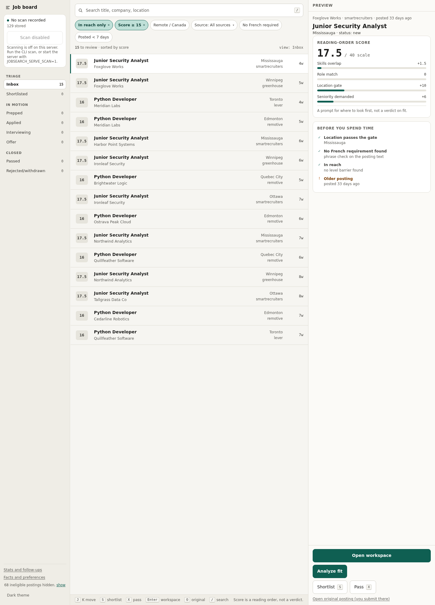

# Offline demo walkthrough

> Back to the main [README](../README.md). Prerequisite: Python 3.13 or later. Use `uv` if it is installed; if not, use `pip` (see [Quick start](../README.md#quick-start)). Recorded against commit `a03ef6f` ([full SHA](https://github.com/tfwe/jobsearch-public/commit/a03ef6ff8a07d1d8cdbfee842fd91237d52151de) `a03ef6ff8a07d1d8cdbfee842fd91237d52151de`). Note the known SHA lag: `a03ef6f` is the last commit that changed the demo commands or the recorded outputs; this README lives in later, docs-only commits (the ref was last set at `07f3c4c`, which changed only this line), so the recorded-against ref always lags the tree's HEAD by design. If a commit after `a03ef6f` touches `tools/`, `tests/`, or `demo/corpus/`, the recorded outputs must be re-run and this ref bumped.

This repository can be exercised end to end with no network, no model and no personal data. `tools/make_fixture.py` builds a synthetic SQLite store from the captured board payloads in `samples/` plus the synthetic corpus in `demo/corpus/`, scores every posting against the synthetic profile in `tests/fixture_facts.yaml`, and everything below runs against it. Every command was run once in a fresh clone and its output is recorded verbatim.

## 1. Run the test suite

```sh
python3 -m venv .venv
uv pip install --python .venv/bin/python pytest pyyaml
.venv/bin/python -m pytest -q
```

Recorded output (summary line; the per-test dots are omitted):

```
917 passed in 85.30s (0:01:25)
```

On a clone without the PDF toolchain or node, the same command reports 908 passed and 9 skipped. The main README's [Quick start](../README.md#quick-start) and [Requirements](../README.md#requirements) sections have the details.

Steps 2 to 6 use bare `python`. Activate the venv first (`source .venv/bin/activate`), or the commands run under the system interpreter.

## 2. Build the fixture store

```sh
python tools/make_fixture.py            # writes fixture/jobsearch-fixture.db
```

Recorded output:

```
greenhouse.json                 1 parsed    1 new    0 refreshed
lever.json                      1 parsed    1 new    0 refreshed
ashby.json                      1 parsed    1 new    0 refreshed
workable.json                   1 parsed    1 new    0 refreshed
smartrecruiters.json            2 parsed    2 new    0 refreshed
remotive.json                   1 parsed    1 new    0 refreshed
remoteok.json                   1 parsed    1 new    0 refreshed
arbeitnow.json                  1 parsed    1 new    0 refreshed
corpus.json                   120 parsed  120 new    0 refreshed
scored  129 postings against tests/fixture_facts.yaml (49 above 0.0)
<clone>/fixture/jobsearch-fixture.db  129 postings written
```

(The tool prints the absolute path of the clone it ran in; shown elided here.)

After the eight captured payloads are replayed, the tool adds the synthetic corpus from
`demo/corpus/corpus.json` and then scores all 129 rows with the same pass `rescore` runs,
against the synthetic profile in `tests/fixture_facts.yaml`. The preferences for that
pass come from a path that does not exist, which yields the empty defaults, so the
demo's numbers do not depend on the machine's own `preferences.yaml`.

The build is deterministic: two runs produce byte-identical files, because the tool pins
the clock it stamps into the store (`last_seen`/`first_seen` are second-resolution
timestamps that would otherwise differ between runs). The pinned instant is
2026-11-01T00:00:00+00:00; staleness — a wall-clock property of the real pipeline — is
intentionally frozen here.

```
dcd3251858b8aaf38972acc3f53ff57e97ae0977631352114d84e482a1653b87  fixture/jobsearch-fixture.db
dcd3251858b8aaf38972acc3f53ff57e97ae0977631352114d84e482a1653b87  fixture/jobsearch-fixture.db
```

## 3. Counts by status

```sh
JOBS_DB=fixture/jobsearch-fixture.db python -m jobsearch.cli stats
```

Recorded output:

```
total:          129
new in last 24h: 0
by status:
  new          129
  shortlisted  0
  prepped      0
  applied      0
  interview    0
  offer        0
  rejected     0
  closed       0
  skipped      0
```

## 4. List the stored postings

```sh
JOBS_DB=fixture/jobsearch-fixture.db python -m jobsearch.cli list --limit 14
```

Recorded output:

```
score | status | company               | title                   | location    | uid                        
------+--------+-----------------------+-------------------------+-------------+----------------------------
17.5  | new    | Northwind Analytics   | Junior Security Analyst | Winnipeg    | greenhouse:corpus:0001     
17.5  | new    | Foxglove Works        | Junior Security Analyst | Winnipeg    | greenhouse:corpus:0049     
17.5  | new    | Ironleaf Security     | Junior Security Analyst | Winnipeg    | greenhouse:corpus:0097     
17.5  | new    | Harbor Point Systems  | Junior Security Analyst | Mississauga | smartrecruiters:corpus:0013
17.5  | new    | Ironleaf Security     | Junior Security Analyst | Ottawa      | smartrecruiters:corpus:0037
17.5  | new    | Northwind Analytics   | Junior Security Analyst | Mississauga | smartrecruiters:corpus:0061
17.5  | new    | Tallgrass Data Co     | Junior Security Analyst | Ottawa      | smartrecruiters:corpus:0085
17.5  | new    | Foxglove Works        | Junior Security Analyst | Mississauga | smartrecruiters:corpus:0109
16.0  | new    | Quillfeather Software | Python Developer        | Toronto     | lever:corpus:0034          
16.0  | new    | Meridian Labs         | Python Developer        | Toronto     | lever:corpus:0082          
16.0  | new    | Meridian Labs         | Python Developer        | Edmonton    | remotive:corpus:0022       
16.0  | new    | Brightwater Logic     | Python Developer        | Quebec City | remotive:corpus:0046       
16.0  | new    | Ostrava Peak Cloud    | Python Developer        | Edmonton    | remotive:corpus:0070       
16.0  | new    | Quillfeather Software | Python Developer        | Quebec City | remotive:corpus:0094
```

The fixture now produces differentiated scores: 49 of 129 rows score above 0.0, spread
over seven distinct values — 17.5 (8 rows), 16.0 (7), 12.0 (2), 10.0 (14), 6.0 (2),
4.0 (8) and 2.0 (8) — ranked by the same `score_posting` pass `rescore` runs (section 2).
The nine postings built from the payloads in `samples/` score 0.0 — marketing, ops and
planner titles the profile's role-family gate excludes — and sort to the bottom of the
list; that is the scorer working as designed on real captured payloads, not a gap in the
fixture.

The `show <uid>` command is omitted from this walkthrough; see [What the demo does not do](#what-the-demo-does-not-do).

## 5. Render the dashboard

```sh
JOBS_DB=fixture/jobsearch-fixture.db python -m jobsearch.cli dashboard
```

Recorded output:

```
fixture/dashboard.html
```

The file is self-contained HTML, written inside `fixture/`, and can be opened directly in a browser. A screenshot of the rendered dashboard, taken with headless Chromium against this same fixture store, is in [`demo/screenshot-dashboard.png`](screenshot-dashboard.png):



## 6. Serve and verify auth

The server requires `JOBSEARCH_SERVE_USER` and `JOBSEARCH_SERVE_PASSWORD` and answers HTTP Basic auth on every request. It exits 78 if either variable is unset. The values below are throwaway demo credentials; bind to `127.0.0.1`. `COPILOT_NEON_CMD` points at `tools/stub-model-cli.sh` so the copilot actions in the served UI run offline, with no model and no API key.

```sh
export COPILOT_NEON_CMD="$PWD/tools/stub-model-cli.sh"
JOBSEARCH_SERVE_USER=demo JOBSEARCH_SERVE_PASSWORD=demo-passphrase \
  python -m jobsearch.serve --host 127.0.0.1 --port 8790 --db fixture/jobsearch-fixture.db
```

Server log, recorded:

```
2026-11-26 20:57:18,250 INFO serving on http://127.0.0.1:8790 (auth: Basic, user from JOBSEARCH_SERVE_USER)
```

Without credentials the request is rejected:

```sh
curl -sS -i http://127.0.0.1:8790/ | head -6
```

Recorded output:

```
HTTP/1.0 401 Unauthorized
Server: jobsearch-serve
Date: Fri, 27 Nov 2026 01:56:42 GMT
Content-Type: text/plain; charset=utf-8
Content-Length: 13
X-Content-Type-Options: nosniff
```

With the demo credentials the dashboard is served:

```sh
curl -sS -u demo:demo-passphrase http://127.0.0.1:8790/ | head -10
```

Recorded output (first lines of the dashboard HTML):

```
<!DOCTYPE html>
<html lang="en"><head><meta charset="utf-8"><meta name="viewport" content="width=device-width, initial-scale=1"><title>Job board — triage</title><style>
*,*::before,*::after{box-sizing:border-box}
:root{color-scheme:light;--bg:#f6f5f1;--bg2:#efede6;--bg3:#fbfaf7;--card:#ffffff;--ink:#1b1b1a;
--ink2:#3d3c38;--muted:#5f5e59;--line:#dedcd3;--line2:#cfcdc4;--line3:#e6e4dc;
--acc:#0f5f52;--onacc:#ffffff;--acc2:#bfe0d8;--s2t:#0b3d35;--warnb:#fde9d2;
--warnt:#7a3b00;--warnl:#f0c79a;--warnbar:#b4540a;
--r:8px;--rl:12px;
--font:Inter,system-ui,-apple-system,"Segoe UI",Roboto,Helvetica,Arial,sans-serif;
--mono:"JetBrains Mono",ui-monospace,SFMono-Regular,"DejaVu Sans Mono",Menlo,monospace}
```

Stop the server with Ctrl-C. It writes nothing; the only files the demo created are `.venv/` and everything under `fixture/`.

## 7. Larger corpus and recorded traces

`demo/corpus/` holds a synthetic corpus of 120 postings, generated by `tools/build_demo_corpus.py`, and the traces recorded by `tools/record_traces.py` against it. Every company, location, title, description and URL is invented. URLs use the `example.invalid` domain. The only values taken from `samples/` are the source board name and a `derived_from` sample file name. Since the fixture change in section 2, `tools/make_fixture.py` also inserts this corpus into the fixture store and scores it, so the demo's ranked list and dashboard are driven by these synthetic postings.

The reach mix is 40 `in_reach`, 40 `stretch` and 40 `out_of_reach`.

Reproduce from the repo root:

```sh
python tools/build_demo_corpus.py
python tools/record_traces.py
```

Recorded counts from `record_traces.py`:

- 120 postings loaded and classified with `reach.classify`.
- 40 posted to the server and answered HTTP 409 (out of reach).
- 80 queued with HTTP 200 and run through the stub model CLI.
- One out-of-reach posting reposted with `force=1`, followed to state `done`, with artifact `analysis.md`.
- Validator: `copilot.validate` runs with facts from `tests/fixture_facts.yaml`. All three canned stub outputs pass. Six seeded-bad variants, one per rule (`unverified_metric`, `project_proper_noun`, `non_ascii`, `FRENCH_BLOCKER`, `greeting`, `code_tokens`), each record their `problems` list.

Files in `demo/corpus/`:

- `corpus.json`: the 120 postings.
- `trace-reach-409.txt`: the reach and 409-gate trace.
- `trace-validator.txt`: the validator trace.
- `SHA256SUMS`: checksums for the three files above.

Determinism: the corpus builder uses no random module, no network and no clock. It computes everything from index arithmetic, so two runs produce byte-identical `corpus.json`.

## 8. A real interaction that failed (sanitized)

The traces above are recorded against the stub. The pipeline also produces traces from
real deployments, and real model sessions sometimes fail in instructive ways. A real
`facts_update` job whose structured edit was rejected by the apply check — and the
failure's fix and regression test — is documented in
[`demo/trace-llm-rejection.md`](trace-llm-rejection.md). Identifiers, device and network
details are removed; the rest is quoted from the deployment's job record.

## What the demo does not do

- Two commands are deliberately absent: `python -m jobsearch.cli scan` and `python -m jobsearch.cli sources --check` both need network access. Nothing here fetches anything. The demo never runs either command.
- `show <uid>` also works offline and prints the full stored posting, including the posting's real source URL from the captured payload; its output is omitted here for that reason.
- It writes nothing outside `fixture/` (and `.venv/` if you created it).
- It prepares nothing, applies to nothing and sends nothing. That is the pipeline's own rule, not just the demo's: every output is a local file for a person to read.
- The fixture store holds the nine postings built from the captured public payloads in `samples/` plus the 120-posting synthetic corpus from `demo/corpus/`, scored against the synthetic profile in `tests/fixture_facts.yaml` (section 2). No profile, packet, letter or store from the private deployment is in this repository; see [What is not in this repository](../README.md#what-is-not-in-this-repository) in the main README. Its postings are generated by `tools/build_demo_corpus.py`, and the only values drawn from `samples/` are a source board name and a `derived_from` file name. The one real artifact here is the sanitized failure trace (section 8); its personal and deployment identifiers are removed, as that file's sanitization note documents.
